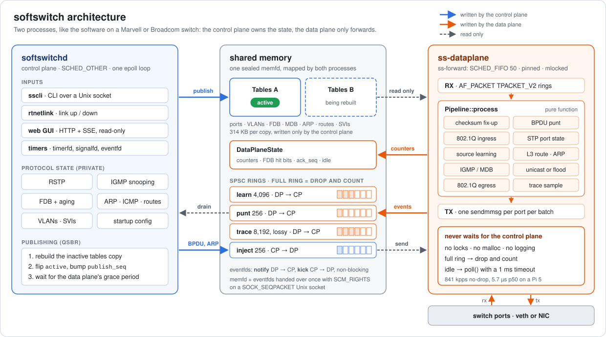
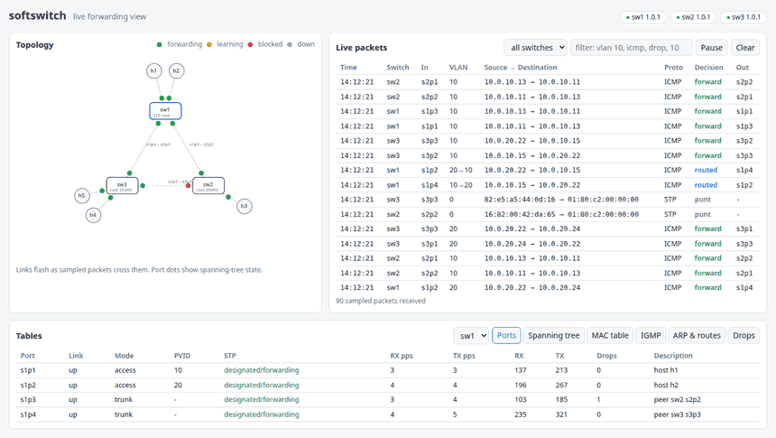
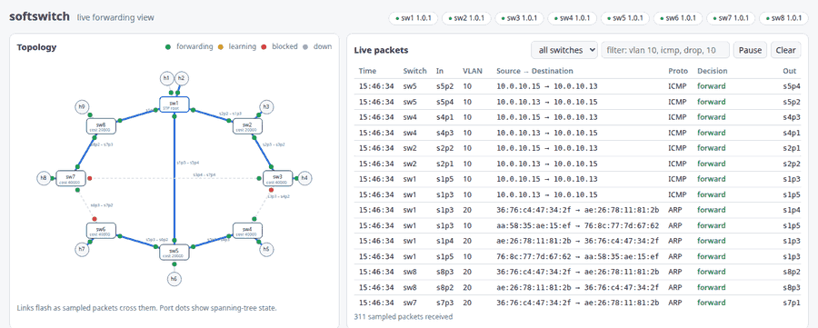

# softswitch

[](https://github.com/Yusufss4/softswitch/actions/workflows/ci.yml)
[](https://github.com/Yusufss4/softswitch/actions/workflows/codeql.yml)
[](https://github.com/Yusufss4/softswitch/releases)
[](LICENSE)


A small user-space L2/L3 Ethernet switch for Linux, written in C++20. It's structured
like the software stack on a Marvell or Broadcom switch: a **control plane** owns
configuration and protocol state, and a separate, pinned, real-time **data plane** forwards
packets using tables the control plane publishes through shared memory.

**On a Raspberry Pi 5:**
- **841 kpps** forwarded without loss with 64-byte frames, **6.7 Gb/s** with 1500-byte frames;
- **5.7 µs** median and **7.5 µs** p99.9 one-way latency at 100 kpps;
- the forwarding thread **never waits for the control plane**. With a real-time CPU hog on the
  control plane's CPU, a lock-based design stalls forwarding for 13 ms, and this one doesn't.

See [the benchmark](docs/benchmark.md) and [the design note](docs/design.md).

## Features
- **802.1Q VLANs:** tag insert and strip, access and trunk ports, native VLAN, ingress and egress filtering
- **MAC learning, flooding and aging.** The data plane sets hit bits, and the control plane ages entries
- **Rapid Spanning Tree** (reduced RSTP): proposal/agreement handshakes, failover in under a second across three switches
- **IGMP snooping** with querier and mrouter ports, so multicast reaches only members
- **L3:** SVIs, ARP, ICMP echo, routing between VLANs and static routes
- **Control plane:** startup config in CLI syntax, `sscli`, rtnetlink link monitoring, all in one epoll loop
- **Data plane:**
  - AF_PACKET TPACKET_V2 rings and `sendmmsg` batching;
  - a SCHED_FIFO forwarding thread, pinned and memory-locked;
  - no locks, allocation or logging on the forward path.
- **IPC:** a sealed memfd with double-buffered tables published lock-free (QSBR), SPSC rings, and eventfds
- **Web GUI:** live forwarding decisions on a topology view
- **Tooling:** `ss-pktgen`, `ss-sink` and `ss-hog`, plus scripts for the benchmark, the `perf` flame graphs and the priority-inversion demo

## Try it

    cmake --preset release && cmake --build --preset release
    scripts/topo.sh up --loop && scripts/switches.sh start   # 3 switches in a loop, 5 hosts
    sudo ip netns exec h1 ping 10.0.10.13                 # h1 -> h3 across two switches
    sudo ip netns exec h1 ping 10.0.20.22                 # h1 -> h2, routed VLAN 10 -> 20 by sw1
    build/release/sscli -s sw2 show spanning-tree        # one port blocks the loop
    build/release/sscli -s sw1 show mac address-table
    build/release/sscli -s sw1                            # interactive CLI
    # browse http://<pi>:8081/ for the live view
    scripts/switches.sh stop && scripts/topo.sh down

    # Eight switches in a ring with two chords; the GUI takes the switch list in ?sw=
    export TOPOLOGY=large
    scripts/topo.sh up --loop && scripts/switches.sh start   # GUI on 8081-8088
    # browse http://<pi>:8081/?sw=<pi>:8081,<pi>:8082,...,<pi>:8088

## Architecture



The [design note](docs/design.md) covers the control path and the data path, table ownership,
threading, and the priority inversion this design avoids, with measurements.

## Web GUI

Every `softswitchd` can serve a read-only page (`--http-port`; `scripts/switches.sh` uses
8081-8083). Open `http://<pi>:8081/` to watch the three switches: the topology with spanning-tree
port states, links flashing as sampled packets cross them, a filterable live trace of forwarding
decisions (forwarded, flooded, routed, punted, dropped and why), and the MAC, IGMP, ARP and route
tables. Sampling is set per switch with `trace sample N`.



*Recorded live from the Pi while hosts ping inside VLAN 10, inside VLAN 20 and across them (routed
by sw1). After a few seconds the sw1–sw2 link goes down. RSTP unblocks the standby sw2–sw3 link,
the switches flood briefly while their MAC tables relearn, and traffic reroutes through sw3 without
a lost ping. When the link returns, the original tree is restored.*

### Eight switches



*Eight switches in a ring with two chords (`TOPOLOGY=large`), so RSTP has three loops to break.
Four flows cross the network: inside VLAN 10, inside VLAN 20, and two routed by sw1. The sw1–sw5
chord fails, then the sw1–sw8 link as well. Each time the tree rebuilds (watch the blocked
ports and the path costs), the other chord takes over, and no flow loses a ping. Then both links
return. The same scenario runs in CI as an integration test
([tests/integration/test_large.sh](tests/integration/test_large.sh)).*

## Build

Requires CMake ≥ 3.21, Ninja, a C++20 compiler (GCC 12+ / Clang 14+) and GoogleTest.

    cmake --preset dev
    cmake --build --preset dev
    ctest --preset dev

Release packages for Raspberry Pi OS / Debian bookworm (arm64 and amd64) are attached to every
[GitHub release](https://github.com/Yusufss4/softswitch/releases).

## Quality gates
Every pull request runs:

| Check | Tooling |
|---|---|
| Format & hygiene | pre-commit, clang-format 18, `.editorconfig` |
| Build & unit tests | GCC and Clang on x86-64 and arm64, plus Debian bookworm (the Pi's toolchain) |
| Sanitizers | ASan + UBSan, TSan |
| Static analysis | clang-tidy, Cppcheck (HTML report), CodeQL |
| Dynamic analysis | Valgrind memcheck (XML report) |
| Coverage | gcovr: HTML report, with the summary posted on the PR |
| Fuzzing | libFuzzer + ASan/UBSan |
| Performance | Google Benchmark, compared against the main branch's baseline |

See [CONTRIBUTING.md](CONTRIBUTING.md) for running these locally.

## Benchmark

```sh
scripts/bench.sh            # pps sweep, no-drop rate, latency histograms
scripts/perf.sh             # perf stat + flame graph of the forwarding thread
scripts/inversion.sh        # QSBR vs mutex vs mutex+PI under a real-time CPU hog
```

Results and analysis are in [docs/benchmark.md](docs/benchmark.md). One result: the TX ring
looked like the zero-copy fast path, but profiling showed it costs a page allocation and a copy
per packet on veth. Switching to batched `sendmmsg` raised the no-drop rate by 29%.

## Documentation
- [Design note](docs/design.md): control path vs data path, table ownership, threading, priority inversion
- [Benchmark](docs/benchmark.md): throughput, latency, perf profile, the `sendmmsg` optimisation
- API reference: <https://yusufss4.github.io/softswitch/> (published with each release)

## License
[MIT](LICENSE)
