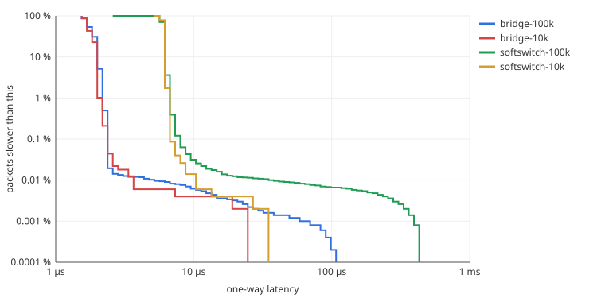
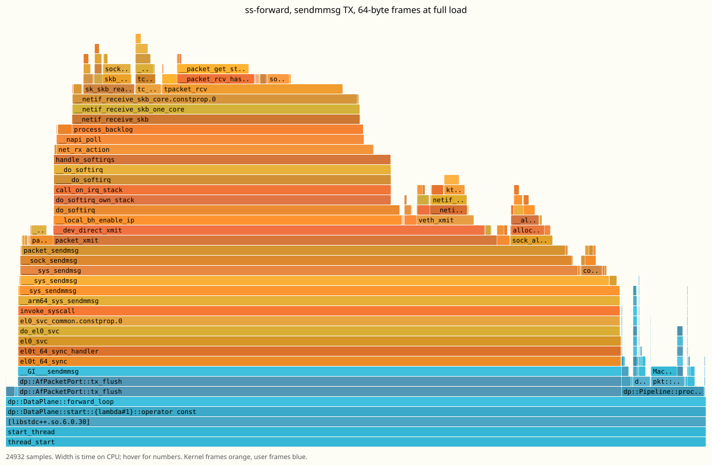
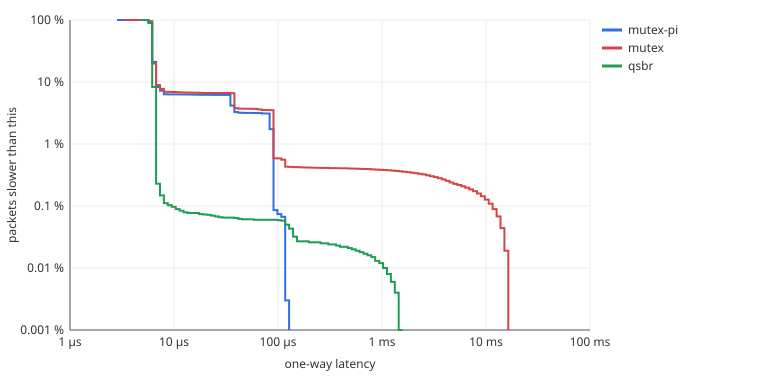

# softswitch benchmark

These are measured numbers from a Raspberry Pi 5:
- forwarding throughput, as the no-drop rate and at saturation;
- one-way latency;
- a `perf` profile of the forwarding thread;
- one optimisation the profile pointed to, with before and after numbers.

[design.md](design.md) explains the architecture and covers the priority-inversion experiment.
All raw data is in [benchmark/](benchmark/).

## Setup

| | |
|---|---|
| Board | Raspberry Pi 5 Model B, 4 × Cortex-A76 at up to 2.4 GHz, 8 GB |
| Kernel | 6.12.47+rpt-rpi-2712 (Raspberry Pi OS, PREEMPT), no `isolcpus`/`nohz_full` |
| CPU frequency | `ondemand` governor, so CPUs that just went busy run at 2.4 GHz and idle ones drop to 1.6 GHz |
| Compiler | GCC 12.2, `-O2 -g` (`release` preset) |
| softswitch | v1.0.0 candidate, `ss-dataplane --tx-mode sendmmsg` (default), batch 64 frames per port |

```
 netns bgen                 root netns                      netns bsink
┌──────────────┐  veth  ┌─────────────────────────┐  veth  ┌──────────────┐
│ ss-pktgen    │──────▶│ b1p1   softswitch   b1p2 │──────▶│ ss-sink      │
│ CPU 1        │        │  CP: CPU 0  DP: CPU 3    │        │ CPU 2        │
└──────────────┘        └─────────────────────────┘        └──────────────┘
                         or: Linux bridge (baseline)
```

- **Traffic.**
  - `ss-pktgen` sends Ethernet/IPv4/UDP frames from an AF_PACKET TX ring, paced by busy-waiting.
  - Each frame carries a sequence number and a `CLOCK_MONOTONIC` timestamp.
  - The sink's MAC is a static FDB entry, so every frame is known unicast.
  - Frame sizes are quoted with the 4-byte FCS, as on a wire: a 64-byte frame is 60 bytes in the socket.
- **Latency** is `CLOCK_MONOTONIC` at `ss-sink` minus the timestamp in the frame. The clock is
  shared by all network namespaces. Each figure includes:
  - the generator's TX ring;
  - two veth hops;
  - the switch;
  - the sink's RX ring and wakeup.

  Every sample is kept, so the percentiles are exact.
- **Loss attribution.**
  - The switch reports the frames the kernel dropped at its ingress RX ring (`PACKET_STATISTICS`, the `RX ring full` column in `show counters`).
  - The sink reports its own ring drops.
  - Generator − sink = total loss.
- **No-drop rate (NDR).** RFC 2544 style: a binary search, 8 steps of 2 s, for the highest
  offered rate with < 0.01% loss. A trial where the generator can't reach the target rate counts
  as a failure.
- **What the Linux bridge baseline measures.**
  - The bridge forwards *inside the generator's transmit call*, because veth delivers synchronously.
  - Its forwarding work is therefore billed to CPU 1, and the generator slows to the bridge's pace.
  - It never loses a frame, and its NDR is the sender-limited rate. It isn't a measure of the
    bridge's own capacity on a dedicated CPU, which is what softswitch gets.
  - So it's a reference point, not a like-for-like contest.

To reproduce, on the Pi with sudo:

```sh
cmake --preset release && cmake --build --preset release
scripts/bench.sh                     # throughput, NDR, latency  -> reports/bench/
scripts/perf.sh sendmmsg             # perf stat + flame graph   -> reports/perf/sendmmsg/
scripts/perf.sh ring
scripts/inversion.sh                 # priority-inversion demo   -> reports/inversion/
scripts/bench_report.py reports/bench   # Markdown tables + latency chart
```

## Throughput

### No-drop rate

| Path | 64 B | 512 B | 1500 B |
|---|---|---|---|
| **softswitch** (`sendmmsg` TX) | **841 kpps** | **693 kpps** | **558 kpps** (6.7 Gb/s) |
| softswitch, `PACKET_TX_RING` TX | 652 kpps | – | – |
| softswitch, `sendto` per packet | 697 kpps | – | – |
| Linux bridge (sender-limited, see above) | 638 kpps | 571 kpps | 497 kpps |

### At saturation (generator at full speed)

| Path | Frame | Offered | Forwarded | Loss | Where the loss happened |
|---|---|---|---|---|---|
| softswitch | 64 B | 1.02 Mpps | 814 kpps | 19.9% | 100% at the switch's ingress RX ring |
| softswitch | 512 B | 905 kpps | 710 kpps | 21.5% | 100% at the switch's ingress RX ring |
| softswitch | 1500 B | 829 kpps | 575 kpps | 30.6% | 100% at the switch's ingress RX ring |
| softswitch, TX ring | 64 B | 1.06 Mpps | 632 kpps | 40.6% | 100% at the switch's ingress RX ring |
| softswitch, `sendto` | 64 B | 1.04 Mpps | 661 kpps | 36.6% | 100% at the switch's ingress RX ring |

Overload behaves as it should. The forwarding thread runs flat out, and the excess is dropped at
the one place designed for it: the kernel, before the frame reaches the data plane's RX ring.
Nothing is lost on egress or at the sink. Latency under overload, about 1.3 ms, is the queueing
delay of a full 1,024-frame ring (1,024 frames / 814 kpps = 1.26 ms) and nothing else.

## Latency

64-byte frames at fixed rates well below saturation:

| Path | Rate | p50 | p90 | p99 | p99.9 | max |
|---|---|---|---|---|---|---|
| softswitch | 10 kpps | 5.7 µs | 6.0 µs | 6.2 µs | 6.6 µs | 33 µs |
| softswitch | 100 kpps | 5.7 µs | 6.0 µs | 6.3 µs | 7.5 µs | 429 µs |
| Linux bridge | 10 kpps | 1.6 µs | 1.9 µs | 2.0 µs | 2.3 µs | 23 µs |
| Linux bridge | 100 kpps | 1.8 µs | 1.9 µs | 2.1 µs | 2.3 µs | 107 µs |



softswitch's distribution is tight: p50 to p99.9 spans 5.7 to 7.5 µs. The roughly 4 µs over the
bridge is the cost of forwarding in user space:
- the ingress frame waits in the switch's RX ring until `ss-forward` wakes up (the bridge has no
  wakeup);
- the frame is copied out of the ring into an skb on transmit;
- there is a second pass through the veth and AF_PACKET receive path.

The rare outliers in the 100 kpps run (0.01% of packets above 100 µs) are scheduling noise on
CPUs that are not isolated. They appear at the same rate whatever softswitch is doing (see
[design.md](design.md#priority-inversion-and-how-it-is-avoided)).

## Where the time goes

`scripts/perf.sh` saturates the switch with 64-byte frames. It then attaches `perf stat` and
`perf record --call-graph dwarf` to the `ss-forward` thread only. Per forwarded packet:

| TX mode | Forwarded | Cycles / packet | Instructions / packet | IPC | L1d misses / packet | LLC misses / packet |
|---|---|---|---|---|---|---|
| **`sendmmsg`** | 812 kpps | **2,950** | 6,063 | 2.06 | 21.9 | 3.4 |
| `PACKET_TX_RING` | 633 kpps | 3,786 | 7,089 | 1.87 | 25.9 | 6.5 |

[](benchmark/flamegraph-sendmmsg.svg)

*Kernel frames are orange, user frames blue. The SVG shows sample counts on hover. The TX ring
version is [here](benchmark/flamegraph-ring.svg), and the top symbols are in
[perf-report-sendmmsg.txt](benchmark/perf-report-sendmmsg.txt).*

**86% of the forwarding thread's cycles are in the kernel. `Pipeline::process`, all of the
switching logic, is 12%.** The biggest pieces:

- **`sendmmsg` → `veth_xmit` → softirq receive on the other end (most of the graph).** veth
  delivers synchronously. The sink namespace's receive path, including `tpacket_rcv` copying the
  frame into the sink's ring, therefore runs on the switch's CPU, inside its `sendmmsg` call. On a
  physical NIC that work would belong to someone else.
- **`__packet_get_status` (12%).** AF_PACKET reads a ring slot's status word before filling the
  slot, and on arm64 it also calls `flush_dcache_page`. This is the *sink's* RX ring, filled on
  our CPU for the reason above. `ss-sink` busy-polls the same status words from CPU 2, so most of
  these loads are probably cross-core cache-line transfers rather than cache hits.
- **The user-space hot spots** are `fdb_lookup`, `MacAddress::from_bytes` (4%, the 6-byte loads
  for the source and destination addresses) and the RX ring walk. None of them is big enough to
  be worth tuning while the kernel I/O path costs seven times as much.

Faster forwarding on this hardware therefore means less kernel per packet, not a faster pipeline.

## The optimisation: `sendmmsg`

The first profile of the TX ring mode, the expected fast path, did not look like a fast path:

- **`skb_copy_ubufs` (4.4%) and page allocation** (`__alloc_pages`, `get_page_from_freelist`,
  `__update_cpu_freelist_fast`). `tpacket_snd` builds each skb with the payload as page
  fragments that point into the TX ring. When the skb crosses into another namespace (veth), the
  kernel must not let the receiver see user-owned pages. So it allocates fresh pages and copies
  the payload anyway.
- **`__packet_get_status` and `packet_sendmsg`** walking ring slots with cache maintenance on each.

The "zero-copy" ring ends up doing a page allocation *and* a copy for every packet. Plain
`sendto` (one copy into a linear skb, no fragments) was already faster at 697 vs 652 kpps NDR,
despite one syscall per packet. The fix keeps the linear copy and drops the per-packet syscall:
- **Staging.** `tx()` copies the frame into a preallocated per-port staging slot (64 slots, sized at startup).
- **Flushing.** `tx_flush()` hands the whole batch to the kernel with one `sendmmsg()`.
- **Overflow.** A full batch is flushed early.
- **Refusals.** Frames the kernel refuses are counted, not retried.

| | `PACKET_TX_RING` | `sendto` | **`sendmmsg`** | Change vs TX ring |
|---|---|---|---|---|
| NDR, 64 B | 652 kpps | 697 kpps | **841 kpps** | **+29%** |
| Forwarded at saturation, 64 B | 632 kpps | 661 kpps | 814 kpps | +29% |
| Cycles per packet | 3,786 | – | 2,950 | −22% |
| LLC misses per packet | 6.5 | – | 3.4 | −48% |

`sendmmsg` is now the default (`--tx-mode sendmmsg|ring|sendto`). The TX ring stays available:
on a physical NIC that keeps the fragments it could still win, and the benchmark would show it.

## A benchmark bug the profile caught

The first full run reported a 64-byte NDR of only 369 kpps with the TX ring, against 509 kpps
forwarded at saturation. The profile showed `ip_route_input_slow`, `ip_rcv_core` and
`__skb_flow_dissect` on the forwarding CPU. That was the *sink's* IP stack: veth delivered each
frame into the sink namespace synchronously, and the IP layer there tried to route a UDP packet
addressed to someone else, all billed to the switch.

The sink now drops frames at tc ingress (`tc filter add dev eth0 ingress matchall action drop`).
Packet sockets see frames before tc ingress runs, so `ss-sink` still counts every one, and the
bridge baseline gets the same treatment. The TX ring's NDR went from 369 to 652 kpps without
touching softswitch. Without the profile, that would have been reported as the switch's
performance.

## Priority inversion

Covered in [design.md](design.md#priority-inversion-and-how-it-is-avoided). In summary, with a
SCHED_FIFO 30 hog on the control plane's CPU and the tables republished 1,000 times a second:

| Publish mode | p99 | p99.9 | Longest data-plane wait |
|---|---|---|---|
| **qsbr** (shipped) | 6.4 µs | 9.1 µs | no lock |
| shared mutex | 85 µs | 11.0 ms | 13.3 ms |
| shared mutex + priority inheritance | 84 µs | 90 µs | 114 µs |



## Raw data

| File | Contents |
|---|---|
| [forwarding.jsonl](benchmark/forwarding.jsonl) | Every saturation and fixed-rate run (generator, sink and switch counters) |
| [ndr.jsonl](benchmark/ndr.jsonl) | No-drop rate per path and frame size |
| `latency-*.csv` | Latency histograms, 8 log-spaced buckets per octave |
| [perf-stat-sendmmsg.txt](benchmark/perf-stat-sendmmsg.txt), [perf-stat-ring.txt](benchmark/perf-stat-ring.txt) | `perf stat` of `ss-forward` |
| `perf-report-*.txt`, `flamegraph-*.svg` | Top symbols and flame graphs |
| `inversion*.{jsonl,csv,txt}` | The inversion runs and the data plane's lock-wait counters |
| `qsbr-control-*.jsonl` | QSBR control runs: neither hog nor republishing / republishing only / hog only |
