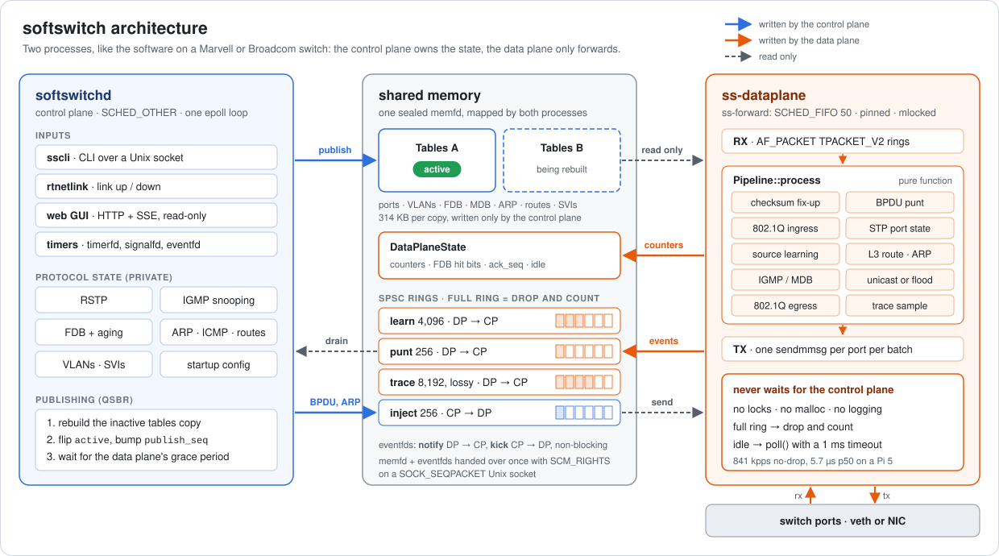
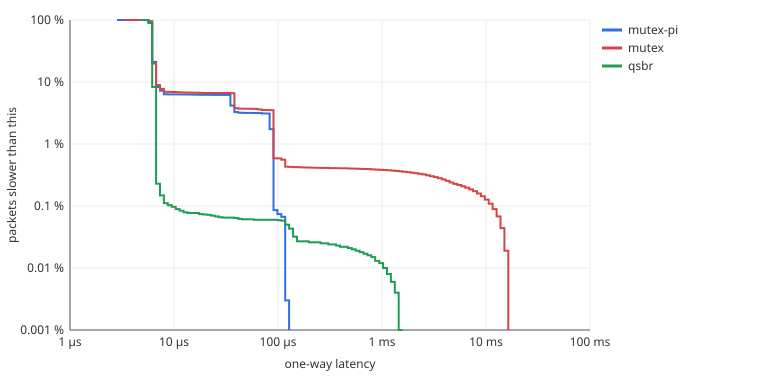

# softswitch design

softswitch is a small Linux switch split the way the software on a Marvell or Broadcom switch is
split. A **control plane** owns every table and runs the protocols. A **data plane** forwards
packets using only tables the control plane has published, and it never waits for the control
plane. This note covers the control path and the data path, who owns which table, the threading
and real-time choices, and the priority inversion the design is built to avoid (with
measurements). [benchmark.md](benchmark.md) has the numbers.

| | Control plane `softswitchd` | Data plane `ss-dataplane` |
|---|---|---|
| Counterpart on a hardware switch | Switch OS application on the host CPU, driving the SDK | ASIC forwarding pipeline |
| Threads | One: an epoll event loop | A main thread (control socket, signals) plus the forwarding thread `ss-forward` |
| Scheduling | `SCHED_OTHER` | `ss-forward`: `SCHED_FIFO` 50, pinned to one CPU, `mlockall` |
| Owns | All configuration and protocol state; writes the published tables | Counters, hit bits, its own RX/TX rings |
| Talks to | CLI (`sscli`), rtnetlink, web GUI, the data plane | The control plane, through shared memory only |

## The two processes



Arrows are coloured by who writes: blue for the control plane, orange for the data plane. Dashed
grey arrows only read.

**Handshake.** At startup the control plane creates the region in a memfd. It seals the size
(`F_SEAL_SHRINK | F_SEAL_GROW | F_SEAL_SEAL`), maps it with `MAP_POPULATE`, publishes a first
table, and listens on `<run-dir>/<name>.dp.sock`, a `SOCK_SEQPACKET` Unix socket. The data plane
connects and sends a hello with the region magic and layout version. The control plane replies
with three descriptors over `SCM_RIGHTS`: the memfd, a *notify* eventfd (DP→CP) and a *kick*
eventfd (CP→DP). The data plane checks the magic, version and size of the mapped region before
using it, so control and data plane binaries from different builds refuse to work together
instead of misreading each other's memory.

**Failure.** If the data plane exits or crashes, the control plane sees `EPOLLRDHUP` on the
socket and marks it detached (`attached = 0`, `idle = 1`), so table publishes stop waiting for
it. A restarted data plane attaches to the same region and forwards with the current tables at
once. Only one data plane may attach at a time.

## Who owns what

Every byte of shared memory has exactly one writer, with a single exception (the hit bits,
below). That rule removes the need for locks, and it is the same rule a switch SDK follows: the
host writes the hardware tables, and the ASIC writes the counters and the learn FIFO.

| State | Where | Writer | Reader | Notes |
|---|---|---|---|---|
| Startup and running config, VLAN names, port descriptions | CP heap | CP | CP | `show running-config` round-trips it |
| FDB with timestamps, static entries, learning policy | CP heap (`l2::Fdb`) | CP | CP | The authoritative MAC table |
| RSTP bridge and port state machines | CP heap (`stp::Rstp`) | CP | CP | Pure: the clock and BPDU TX are injected |
| IGMP groups, member timers, mrouter ports | CP heap (`igmp::Snooper`) | CP | CP | |
| SVIs, ARP cache, pending resolutions, routes | CP heap (`l3::Router`) | CP | CP | |
| **Published tables**: ports (PVID, mode, STP state, oper state), VLAN membership/untagged bitmaps, FDB (16,384 slots), MDB (2,048), neighbours (2,048), routes (64), SVIs (16), router MAC | Shared, two copies (314 KB each) | CP | DP | Rebuilt as a whole and published by flipping `active` |
| `active`, `publish_seq` | Shared | CP | DP | |
| `ack_seq`, `idle`, `attached`, heartbeat | Shared | DP (CP on detach) | CP | Grace-period protocol, below |
| Port, drop-reason and ring counters | Shared | DP | CP | Single writer, so relaxed load+store, no atomic RMW |
| FDB hit bitmap (65,536 bits) | Shared | DP sets, CP clears | Both | DP sets a bit only if it is clear (`fetch_or`, so the steady state costs a load); CP harvests with `exchange(0)` every aging tick |
| learn ring (4,096), punt ring (256), trace ring (8,192) | Shared | DP | CP | SPSC; a full ring drops and counts, the DP never waits |
| inject ring (256) | Shared | CP | DP | BPDUs, ARP replies and requests, ICMP, IGMP queries |

The data plane keeps no state of its own that matters to forwarding. Everything it needs is in
the published tables. A data plane restart therefore loses only in-flight packets and counters.

## The data path

`ss-forward` runs one loop. All of the forwarding logic is in `dp::Pipeline`, a pure function of
`(tables, ingress port, frame) → egress actions` with no sockets in it. That is why GoogleTest
can drive the whole pipeline in-process and the fuzzers can feed it arbitrary frames.

```
loop:
  if no RX ring has a frame and the inject ring is empty (checked in user space, no syscall):
      mark idle, poll(ports + kick + stop, 1 ms), continue
  tables = enter()                       # read publish_seq, then tables[active]
  for each port: up to --batch frames from its TPACKET_V2 RX ring
      Pipeline::process(tables, port, frame)
  up to 64 messages from the inject ring
  flush TX for every port                # one sendmmsg() per port with frames queued
  exit()                                 # ack_seq = the sequence this batch used
  if a learn or punt message was queued: one non-blocking eventfd write
```

`Pipeline::process` runs these steps in order:
1. Complete offloaded checksums.
2. Punt BPDUs.
3. 802.1Q ingress: the tag is restored from `tp_vlan_tci`, because veth and AF_PACKET strip it. Then PVID, acceptable frame types and membership. A frame with a second tag behind the first is dropped (`stacked-tag`): there is no Q-in-Q, and forwarding it would let the inner tag choose the VLAN at the next switch.
4. Drop reserved multicast.
5. STP port state: discarding drops; learning learns but doesn't forward.
6. Source learning, with a small repeat cache so one new MAC queues one learn event, not one per packet.
7. L3, for frames addressed to the router MAC: ARP and ICMP to an SVI are punted; routed packets get a longest-prefix match, a neighbour lookup, a TTL decrement and an incremental checksum update (RFC 1624), then a MAC rewrite.
8. IGMP snooping: registered groups go to member and mrouter ports, unregistered ones to mrouter ports only.
9. Known unicast goes out of one port; anything else is flooded in the VLAN.
10. On egress, each port tags or untags per VLAN.

A sampled `TraceRecord` (`trace sample N`) goes to the lossy trace ring for the web GUI.

**Port I/O.** Packets reach the data plane through AF_PACKET `TPACKET_V2` RX rings:
- `PACKET_IGNORE_OUTGOING`, so the data plane doesn't see its own transmissions;
- promiscuous mode;
- frames are processed in place in the ring and released in bulk.

The Pi's kernel is built without `CONFIG_XDP_SOCKETS`, which rules out AF_XDP. It would slot in
behind the same `PortIo` interface. `TPACKET_V3` was rejected because its block-retire timer
trades latency for throughput. Transmit has three modes: `sendmmsg` (the default), `ring`
(`PACKET_TX_RING`) and `sendto`. Profiling picked the default: on veth the "zero-copy" TX ring
costs 28% more cycles per packet than batched copies, because the kernel copies the
ring-referenced pages back out with `skb_copy_ubufs` when the frame changes namespace.
[benchmark.md](benchmark.md#the-optimisation-sendmmsg) shows the profiles.

## The control path

`softswitchd` is single-threaded: one epoll loop, timers on `timerfd`, signals on `signalfd`. No
handler blocks; every one of them runs to completion in microseconds. It reacts to these events:

| Event | Source | Typical work |
|---|---|---|
| Data plane notify | eventfd | Drain learn events into `l2::Fdb`; handle punted BPDUs, IGMP, ARP and ICMP |
| Link up/down | rtnetlink `RTMGRP_LINK` | Port oper state, RSTP port enable/disable, FDB flush on the port |
| 1 s tick | timerfd | Harvest hit bits and age the FDB, IGMP timers, ARP retries |
| RSTP hello / proposal retry | timerfd | BPDUs out through the inject ring |
| CLI command | Unix socket | Change config, `show` commands |
| GUI | TCP | `/api/state`, SSE trace stream |

Every change to forwarding state ends in `schedule_publish()`, which coalesces: however many
learn events, link changes and RSTP transitions arrive in one loop iteration, the loop rebuilds
and publishes the tables once, after the iteration.

Things the control plane sends, such as BPDUs, ARP and ICMP replies, and IGMP queries, go through
the inject ring. The data plane transmits them in its next batch, after its VLAN egress
processing, so the control plane never opens a socket on a switch port. The data plane
transmits only on ports it already sees as up. So when a port comes up, the control plane
publishes first and runs RSTP second. Otherwise the first proposal BPDU on the new link would be
dropped, and convergence would wait for the next retry.

## Publishing tables without locks

The control plane never edits the live tables. It rebuilds the inactive copy, then swaps:

```mermaid
sequenceDiagram
  participant CP as control plane
  participant R as region
  participant DP as ss-forward
  DP->>R: enter(): idle=0, seq=publish_seq, read tables[active]
  CP->>R: begin_update(): wait until ack_seq ≥ last seq, or idle, or detached
  CP->>R: rebuild tables[!active]
  CP->>R: active = !active; publish_seq++
  DP->>R: (still using the old copy for this batch)
  DP->>R: exit(): ack_seq = seq
  DP->>R: next enter() reads the new copy
```

This is quiescent-state-based reclamation (QSBR), the userspace version of RCU.
- **One writer, one reader.** Each side has one writer of its own fields, so there is nothing to lock.
- **The data plane's quiescent states** are the end of a batch (`exit()` acknowledges the sequence it used) and being idle in `poll()` (`idle = 1`), where it holds no table.
- **Before reusing a copy, the control plane waits for a grace period.** A copy it just retired can be rewritten only once the data plane has passed a quiescent state.
- **Batches are short.** At most `--batch` frames, and the longest batch measured in the demo below was 40 µs, so the wait is short. If it runs over 5 ms, the publish is deferred and retried 20 ms later, so even a stuck data plane can't block the control plane's loop.

**Memory ordering.**
- **The data plane** stores `idle = 0`, then loads `publish_seq`.
- **The control plane** stores `active` and `publish_seq`, then loads `idle` and `ack_seq`.

This is the store-then-load-the-other-side pattern of Dekker's algorithm. It needs sequentially
consistent operations on both sides: with acquire/release only, each side could miss the other's
store, and the control plane would overwrite a copy in use. A unit test reads under a publishing
stress loop and checks every copy it sees is internally consistent. A negative control, a build
with the grace period disabled, shows that the test does catch torn reads.

The cost is memory: two copies of 314 KB. A full rebuild takes about 80 µs on the Pi (measured
below as the lock hold time), so publishing hundreds of times a second is affordable. Learning
storms coalesce into one publish per loop iteration.

## Threading and real-time

`ss-forward` is set up for bounded latency:
- `SCHED_FIFO` priority 50, pinned (`--cpu`), so nothing at normal priority can preempt it.
- `mlockall(MCL_CURRENT | MCL_FUTURE)`, with the shared region and packet rings mapped
  `MAP_POPULATE`/`MAP_LOCKED`, so the forward path never takes a page fault. A page fault takes
  `mmap_lock`, which a lower-priority thread could be holding.
- **No heap allocation on the forward path.** Every buffer, including the `sendmmsg` staging
  arena, is sized at startup.
- **No logging, no stdio and no locks on the forward path.** Counters go to shared memory, and
  the control plane reports them.
- **No busy-polling.** When there is nothing to do, it sleeps in `poll()` with a 1 ms timeout.
  With `sched_rt_runtime_us = 950000`, a spinning FIFO thread would be throttled for 50 ms every
  second (hundreds of thousands of packets), and it would starve kernel threads on its CPU. The
  cost is a wakeup on the first packet after an idle period; the 5.7 µs p50 at 10 kpps includes it.
- **The data plane never blocks on the control plane.** Rings that are full drop and count. The
  eventfd is non-blocking and written at most once per batch. The control plane is never called
  synchronously.

`softswitchd` runs at normal priority, and that is deliberate. Nothing it does is
latency-critical at the microsecond level: RSTP timers are seconds, and learning has a
few-millisecond budget. Leaving it at normal priority means a busy control plane, a CLI flood or
a slow GUI client can never take CPU from forwarding.

**CPU layout on the Pi.** `scripts/switches.sh` pins the three data planes to CPUs 1–3 and leaves
the control planes to the scheduler. For benchmarks a single switch runs with its control plane
on CPU 0, its data plane on CPU 3, the generator on CPU 1 and the sink on CPU 2.

## Priority inversion and how it is avoided

**The hazard.** Suppose the tables were protected by a lock shared between the two planes:
"take the lock, update the FDB, release it", with the data plane taking the same lock per batch.
The control plane runs at normal priority. If anything with a priority between the two becomes
runnable on its CPU while it holds the lock (a FIFO 30 thread, an interrupt thread, a busy
kernel worker), the control plane is preempted holding the lock. The data plane then waits at
priority 50 for that thread to finish, a wait set by an unrelated task. That is unbounded
priority inversion, the bug that reset Mars Pathfinder.

**The demonstration.** `softswitchd --publish-mode mutex|mutex-pi` swaps QSBR for a
process-shared `pthread_mutex_t` in the region. The control plane holds it for the whole rebuild,
and the data plane takes it around every batch. `scripts/inversion.sh` runs all three modes under
the same load:
- the switch forwards 20 kpps;
- the control plane republishes 1,000 times a second (`--publish-hz`);
- `ss-hog`, a `SCHED_FIFO` 30 task on the control plane's CPU, spins 20 ms out of every 50 ms.



| Publish mode | p50 | p99 | p99.9 | max | Data plane wait for the lock (max) |
|---|---|---|---|---|---|
| **qsbr** (shipped) | 5.9 µs | 6.4 µs | **9.1 µs** | 1.5 ms* | none, there is no lock |
| mutex | 5.9 µs | 85 µs | **11.0 ms** | 15.9 ms | **13.3 ms** |
| mutex + `PTHREAD_PRIO_INHERIT` | 5.9 µs | 84 µs | **90 µs** | 122 µs | 114 µs |

\* The rare millisecond outliers in the QSBR run are not caused by the control plane. They show
up at the same rate with no hog and no republishing (a 3.2 ms max in that control run), and the
data plane's longest batch in the QSBR run was 40 µs. They come from housekeeping on CPUs that
are not isolated (no `isolcpus`/`nohz_full` on this Pi).

- **The plain mutex** turns the hog's 20 ms slice into a 13 ms stall of the forwarding thread.
  The tail curve has a shoulder at 0.4% of packets reaching out to 16 ms.
- **Priority inheritance** bounds the wait. While the data plane waits, the control plane runs at
  priority 50, ahead of the hog, and finishes its critical section. But the bound is the critical
  section itself, about 80 µs. **p99 is still 13× worse than QSBR**, because every rebuild still
  stalls forwarding, and the worst case grows with the table size.
- **QSBR** removes the wait instead of bounding it. The data plane never takes anything the
  control plane holds, so neither the control plane's priority nor its rebuild time appears in
  the forwarding latency at all.

**Inversions that are easy to miss.** Other places the forwarding thread could inherit a
low-priority thread's delay, and how each is avoided:

| Hidden lock | Where it comes from | Avoided by |
|---|---|---|
| `mmap_lock` | Page faults | `mlockall` + prefaulted, locked mappings |
| Allocator arena locks | `malloc`/`new` on the forward path | Every buffer is preallocated |
| stdio and logger locks | Logging per packet | No logging on the forward path; counters only |
| A full queue the CP must drain | Blocking writes into a ring | SPSC rings drop and count when full |
| eventfd counter | Blocking `write()` | `EFD_NONBLOCK`, at most one write per batch |
| The CP's grace-period wait | QSBR itself | Only the CP waits, bounded at 5 ms, then retries |

A crash while holding the lock would hang the lock-based demo modes. Making them safe would take
robust mutexes (`PTHREAD_MUTEX_ROBUST`). They stay demo-only, which is one more argument for
QSBR.

## The web GUI without touching the data path

The GUI reads only what the control plane already has:
- `/api/state` serializes control-plane state and shared counters.
- `/events` streams trace records.

The data plane's only GUI cost is the sampled trace write (`trace sample N`, off by default) into
the lossy trace ring. The control plane drains that ring every 100 ms and fans the records out
over SSE. A slow browser loses events, counted per client, so neither plane ever buffers without
limit. The server is GET-only, so the GUI can't change anything. It has no authentication, so it
should only be exposed on a trusted network.

## Testing the split

- **Unit tests (GoogleTest).** The state machines are pure classes with injected clocks:
  `l2::Fdb`, `stp::Rstp`, `igmp::Snooper`, `l3::Router`, config apply/render. The data path is a
  pure function (`dp::Pipeline`). RSTP is tested as three bridges on a simulated wire.
- **Shared memory.** The publisher, the rings and the torn-read stress test (with its negative
  control) run under TSan in CI.
- **Integration tests.** `tests/integration/` builds the real three-switch triangle in network
  namespaces and checks:
  - VLAN isolation;
  - learning and aging;
  - RSTP convergence and failover (0 of 400 pings lost);
  - IGMP pruning;
  - SVI ping and inter-VLAN routing;
  - the GUI API.
- **Fuzzing.** Fuzzers cover the packet parsers, the pipeline, the config parser and the HTTP
  request parser.

## Limitations

- **Software forwarding over AF_PACKET.** On veth, most of the cycles are kernel I/O (see the
  benchmark). AF_XDP would remove most of that but needs a kernel with `CONFIG_XDP_SOCKETS`.
- **Full rebuilds on every publish.** A real SDK would apply deltas. With 314 KB tables a full
  rebuild is 80 µs, and simple code wins at this scale.
- **Reduced RSTP.** One instance, no MSTP; point-to-point links and edge ports.
- **IPv4 only**, with static routes. IGMP snooping parses v1, v2 and v3 reports but tracks groups, not sources.
- **One data plane per control plane**, with one forwarding thread. Scaling out would shard ports
  across threads, each with its own rings and its own acknowledgement word.
